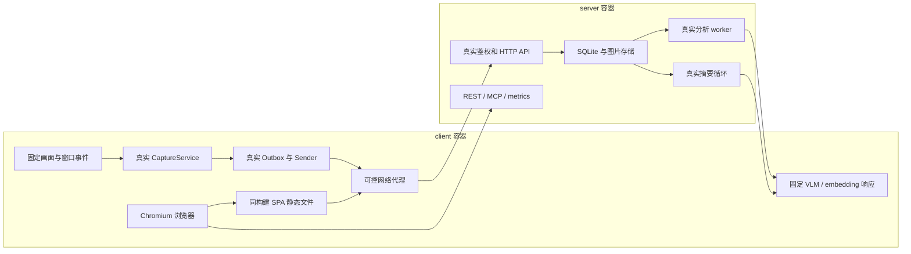

# 开发、验收与可观测性

当前任务顺序见 [PLAN](../../devlogs/PLAN.md)。本页定义代码交付门槛和测试环境。

## 本地检查与 CI

应用、接口、依赖、构建或运行配置改动完成后，在仓库执行：

```powershell
python scripts/check.py all
```

前置环境：Python 3.12+、uv、Node.js 22、Docker 的 Linux engine。分项入口为 `lint`、`unit`、`frontend`、`e2e`。缺少 Docker 或测试失败会返回非零退出码。全部测试证据放在忽略提交的 `artifacts/`。

| 检查 | 本地与 CI 的共同入口 | 验收内容 |
|---|---|---|
| Python 静态检查 | `python scripts/check.py lint` | 应用、测试驱动和检查脚本的 Ruff lint/format |
| 自动化测试 | `python scripts/check.py unit` | 临时数据库、协议、鉴权、存储、恢复、摘要、可观测性；CI 同时运行 Windows/Linux |
| 前端 | `python scripts/check.py frontend` | npm lock 安装、ESLint、TypeScript 和 SPA 构建 |
| 双容器 E2E | `python scripts/check.py e2e` | 真实 TCP、客户端运行组合、服务端入口、worker、摘要循环、MCP、Chromium 浏览器 |
| Windows 制品 | `scripts/windows/build-client.ps1` 和 `verify-client-package.ps1` | 构建安装包，核对版本/ZIP，并运行冻结 EXE 的 `--help` 检查入口依赖 |

CI 的 `quality-gate` 汇总检查结果。服务器镜像发布和 Windows 标签发布都复用整套 CI，检查通过后才发布制品。生产激活使用现有 `timetrace-update`，见 [部署手册](web-deployment.md)。远端分支保护应将 `quality-gate` 设为必需检查；修改工作流本身不等于已配置远端保护。

## 双容器环境



配置在 `qa/e2e/compose.yml`。server 使用 `deploy/Dockerfile` 构建的应用镜像，初始化测试凭据后启动 `timetrace-server`。client 使用同一构建的应用代码，通过 `CaptureSource` 注入模拟窗口、图像与采集时间，运行生产 `_run` 组合。模型替身通过真实 OpenAI 兼容 HTTP 返回固定结果。

Outbox 故障场景在测试驱动中让 `Path.replace` 暂时抛出带 `winerror=5` 的 `PermissionError`，验证整个客户端的重试与恢复；生产入口不含故障注入开关。Windows 单元测试另外使用真实只读文件和拒绝删除共享的 `CreateFileW` 句柄，验证实际 OS 拒绝替换后的恢复。

每次运行创建唯一 Compose project、内部网络和独立命名卷，不映射主机端口。服务端、客户端、浏览器都使用测试身份；样例图片由 Pillow 绘制。运行不加载仓库 `.env`。脚本在结束前导出日志、JUnit、结果 JSON、指标快照、浏览器 trace 和截图，再移除本次 project 的容器和卷。

必须通过的场景：

1. 未鉴权读取业务接口与指标被拒绝。
2. 断网时继续采集并持久化，强制结束客户端后从同一队列恢复。
3. 恢复网络后排空；服务端已接收但回执丢失时重试，记录和图片保持唯一。
4. 模型短暂失败后恢复，真实 worker 写入描述、分类与 embedding。
5. 真实 rollup/narrate 循环生成闭合摘要；MCP latest、overview、精确摘要和分页可读。
6. 服务端容器重启后，原记录 ID 和摘要仍然存在。
7. 浏览器完成登录、首次改密、时间轴详情与缩略图读取、设备页读取，以及客户端暂停/恢复操作。
8. 服务端与客户端指标可读，请求 ID 返回且可在日志中关联；画面标题和机器 token 不进入应用日志。
9. 确认游标替换失败时客户端继续运行，控制接口显示磁盘错误，待发送记录保留且不重复发 HTTP；解除故障后原进程排空队列，服务端记录与图片仍唯一。
10. 向测试服务端上传落在旧摘要缺失子窗里的迟到记录，MCP 总览从 `covered` 变为 `partial`，并返回摘要与当前原始记录的条数。

这些模拟输入验证协议、持久化和进程生命周期。Windows 文件替换拒绝由 `tests/test_outbox_storage_recovery.py` 在本地和 Windows CI 上执行真实系统调用验收；前台窗口读取、实际屏幕采集、托盘和休眠恢复仍需平台验收。真实模型另列质量评估，依赖真实 VLM 凭据的 smoke 测试不参与确定性 E2E。

## 日志

三个入口使用统一 JSON 日志：`client`、`server`、`standalone`。公共字段为 `timestamp`（UTC）、`level`、`service`、`event`；HTTP 请求附带 `request_id`、路由模板、状态码和耗时，worker 附带 `record_id`。客户端日志位于配置数据目录的 `logs/client.log`，5 MiB 轮转、保留三份。容器日志写 stderr，由 Docker 收集。

顶层崩溃记录完整异常组和子异常，再以失败结束。日志处理器删除凭据、认证头、窗口标题、图片字段和请求 URL。首次生成的机器 token 保存在凭据文件，日志只记录文件位置。业务正文、截图和 token 不作为 metrics label。

## 健康检查与指标

| 入口 | 语义与访问方式 |
|---|---|
| 服务端 `/healthz` | 进程 HTTP 存活 |
| 服务端 `/readyz` | 数据库可读、必需后台 task 尚在运行；失败返回 503 |
| 服务端 `/metrics` | 现有鉴权保护；同机 Prometheus 使用 bearer 抓取 API 的 loopback 地址 |
| 客户端 `/metrics` | 现有回环控制接口上的 Prometheus 文本；保留 Host/Origin 边界 |

服务端输出请求量/耗时、分析状态数量、最老待分析年龄、各层摘要状态、最新已完成摘要窗口、后台循环最后成功时间/失败数/任务存活、已接入统一 LLM 账本的请求量/耗时。客户端输出待上传条数/字节/最老年龄、最近采集/上传/报错时间和暂停状态。客户端离线通过抓取失败或上游收件时间判断；指标不把“没有活动”解释为用户离线。

HTTP、后台错误和 LLM counters 从进程启动累积；数据库 gauges 每次抓取最多刷新一次，缓存五秒。最新完成摘要时间表示进度，不证明历史覆盖完整。readiness 表示组件可用，模型上游故障和数据积压通过相应指标判断。

建议监控规则：API `up == 0`、队列年龄持续增长、rollup/narrate 超过预期轮询周期未成功、持续 HTTP 5xx、客户端 Outbox 字节超过预算。阈值结合实际负载确定。生产 Prometheus/Grafana 接入属于部署阶段。

## 后续结构调整

客户端负责采集、隐私控制、可靠待发送存储与清晰状态；服务端负责鉴权、规范记录、分析、派生摘要和查询。离线可靠传输需要持久队列。当前 JSONL、游标文件与 compaction 的多文件一致性由应用手工维护，已有 Windows 替换失败案例。

后续优先评估 SQLite 事务队列，把入队、确认和重试状态放进事务；图片仍由 blob 文件存放。选择以 Windows 文件占用、断电/进程终止、重复回执、离线容量和迁移测试为依据。先完成现有行为的可重现验收，再替换队列实现。生产历史数据整理使用单独的审计、备份、限定范围回填与验收流程。

参考：[Docker Compose 生命周期](https://docs.docker.com/reference/cli/docker/compose/up/)、[Prometheus instrumentation](https://prometheus.io/docs/practices/instrumentation/)、[SQLite 事务保证](https://www.sqlite.org/transactional.html)。
